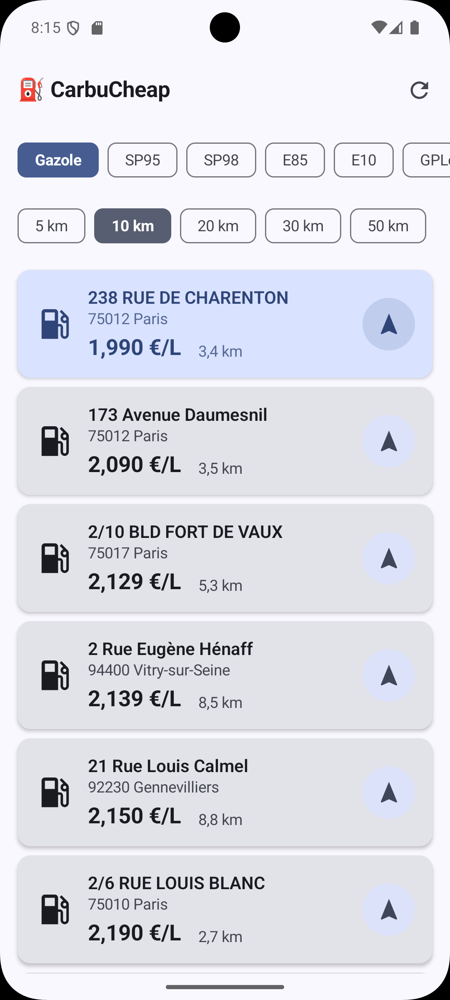
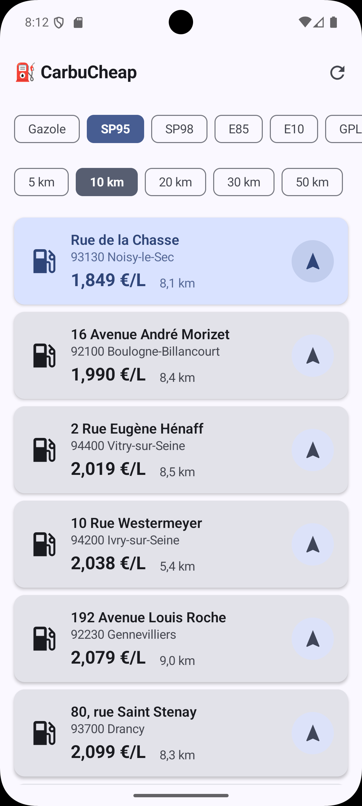
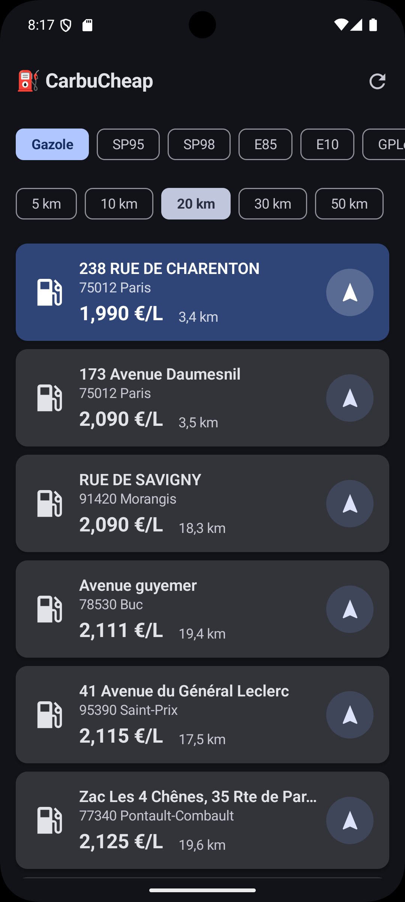

# ⛽ CarbuCheap

Application Android qui trouve les stations-service les moins chères autour de vous, à partir des données officielles du gouvernement français.

[Disponible sur Google Play](https://play.google.com/store/apps/details?id=com.ym.carbucheap)

<p>
  
  
  
</p>

## Fonctionnalités

- Géolocalisation automatique, sans saisie d'adresse
- 6 carburants : Gazole, SP95, SP98, E10, E85, GPLc
- Stations triées du moins cher au plus cher
- Rayon de recherche : 5, 10, 20, 30 ou 50 km
- Lancement de la navigation en un clic (Google Maps ou autre app GPS)
- Carburant et rayon mémorisés entre deux lancements
- Thème clair et sombre
- Aucune publicité, aucun compte, aucune donnée personnelle collectée

## Source des données

Les prix proviennent du jeu de données Open Data [Prix des carburants en France — flux instantané](https://data.economie.gouv.fr/explore/dataset/prix-des-carburants-en-france-flux-instantane-v2/) (Ministère de l'Économie). Le filtrage géographique est fait côté serveur ; les résultats sont mis en cache 15 minutes, ou jusqu'à un déplacement de plus d'1 km.

## Stack technique

- Kotlin, Jetpack Compose, Material 3
- Architecture MVVM : `ViewModel` + `StateFlow`
- Retrofit + Moshi pour l'API
- Fused Location Provider (Google Play Services) pour la position
- DataStore pour les préférences
- Navigation Compose type-safe
- minSdk 26, targetSdk 37

```
app/src/main/java/com/ym/carbucheap/
├── data/
│   ├── location/     # Récupération de la position GPS
│   ├── model/        # Modèles API et domaine
│   ├── remote/       # Client Retrofit
│   └── repository/   # Accès aux prix (+ cache) et préférences
├── ui/
│   ├── navigation/   # Graphe de navigation
│   ├── screen/       # Écrans Compose
│   ├── theme/        # Thème Material 3
│   └── viewmodel/
└── util/             # Distance, formatage, intents de navigation
```

## Compiler le projet

Prérequis : Android Studio récent et JDK 17.

```bash
git clone https://github.com/yoanmarchal/CarbuCheap.git
cd CarbuCheap
./gradlew assembleDebug
```

Aucune clé d'API n'est nécessaire.

### Build de release signé

La signature est lue depuis des variables d'environnement (ou des propriétés Gradle du même nom) :

```
RELEASE_STORE_FILE
RELEASE_STORE_PASSWORD
RELEASE_KEY_ALIAS
RELEASE_KEY_PASSWORD
```

```bash
./gradlew bundleRelease
```

Sans ces variables, le build de release est généré non signé.

## Intégration continue

Le workflow GitHub Actions [`ci-security.yml`](.github/workflows/ci-security.yml) exécute le lint, les tests unitaires et un build debug à chaque push et pull request sur `main`.

## Liens

- [Changelog](CHANGELOG.md)
- [Politique de confidentialité](store-listing/privacy-policy.html)
